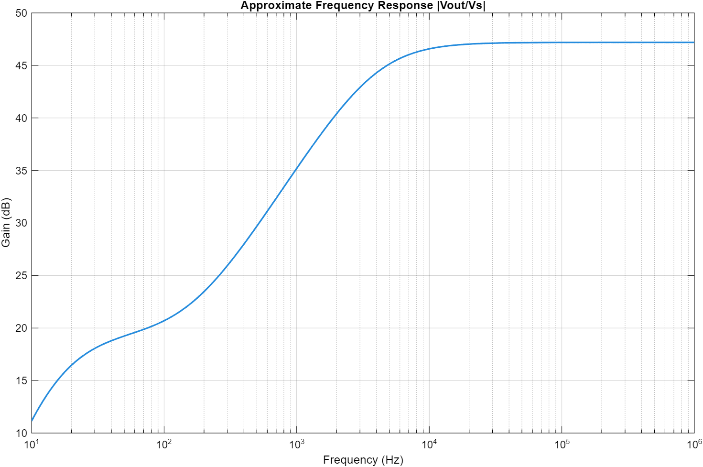

# Two-stage BJT amplifier

**Lars Goozen and Destiny DeLara — EE A333L, Spring 2026.** The final lab combined a common-emitter gain stage with an emitter-follower output stage. The design was explored in MATLAB, simulated in PSPICE, and assembled with two 2N3904 transistors.

The retained models use a 12 V supply, a 180 kΩ/22 kΩ bias divider, a 10 kΩ collector resistor, a 1 kΩ first-stage emitter resistor, and a 1.2 kΩ second-stage emitter resistor. The frequency model adds 1 µF input, bypass, and output capacitors, a 50 Ω source, and a 10 kΩ load.

- `bias_design.m` estimates the operating point, input/output resistance, midband gain, and current draw.
- `frequency_response.m` sweeps 10 Hz to 1 MHz and shows the effect of coupling and bypass capacitors.
- `lab-comparison.json` records selected results from the April 24, 2026 team report, Table 1. It is a historical comparison, not a new measurement.

The report records a measured gain of 45.7 dB, input resistance of 3.98 kΩ, and output resistance of 95.5 Ω. The recovered bias calculation reports about 47.32 dB, 3.516 kΩ, and 96.5 Ω. The model helps explain component choices; it does not replace transistor-level simulation.

## Model limits

Bias calculations neglect base-current loading and approximate collector current as emitter current. The common-emitter gain approximation neglects loading by the following stage. The sweep includes external capacitors but omits transistor parasitic capacitance, Early effect, and clipping, so the plot's high-frequency plateau is not an upper-bandwidth prediction.

The report's output-voltage table and stated input amplitude do not directly reconcile with its listed gain under one peak-to-peak convention. Output swing is therefore omitted from this public comparison pending clarification. No claim is made that the model independently verifies every design requirement. The original PSPICE project/netlist was not recovered.

Source: team final amplifier-design report, April 24, 2026, and recovered MATLAB files `final_lab.m` / `final_lab_freq_tes.m`. Lab assignment: Todd Petersen, UAA.
