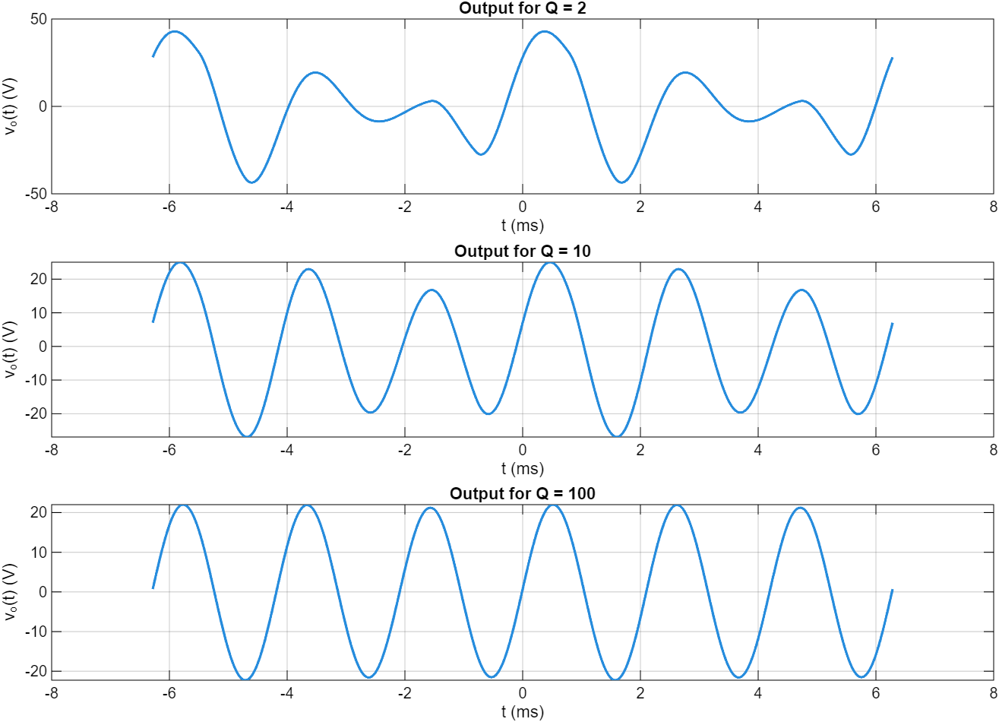

# Fourier reconstruction and RLC filtering

This recovered Circuit Theory calculation reconstructs a periodic signal with a truncated complex Fourier series, then compares a filter response at `Q = 2, 10, 100`. It uses 80 positive and negative harmonics, a period of `2*pi*1e-3` seconds, and a filter centered on the third harmonic.

The coefficient expression is preserved in `fourier_rlc_response.m`. The transfer function is applied to each harmonic before summing the output waveform. Increasing Q concentrates the response near the selected harmonic. The script contains an illustrative `L=0.10 H` and derives the resonant capacitance; the harmonic response itself uses the normalized Q expression.

## Provenance and scope

Recovered from `finalpart12.m` among Lars Goozen's local MATLAB coursework. The approach follows Jens Munk's UAA `Fseries_ex2.m` teaching example, with a different coefficient expression and an added RLC response study. The exact assessment/submission context was not recovered. This is presented as course-derived numerical work, not an independently invented method.

The result is a truncated ideal steady-state response. It does not model circuit start-up, parasitics, component tolerances, or measured hardware. The included plot was regenerated from the recovered source; duplicate waveform drafts and the instructor's original example are excluded.
