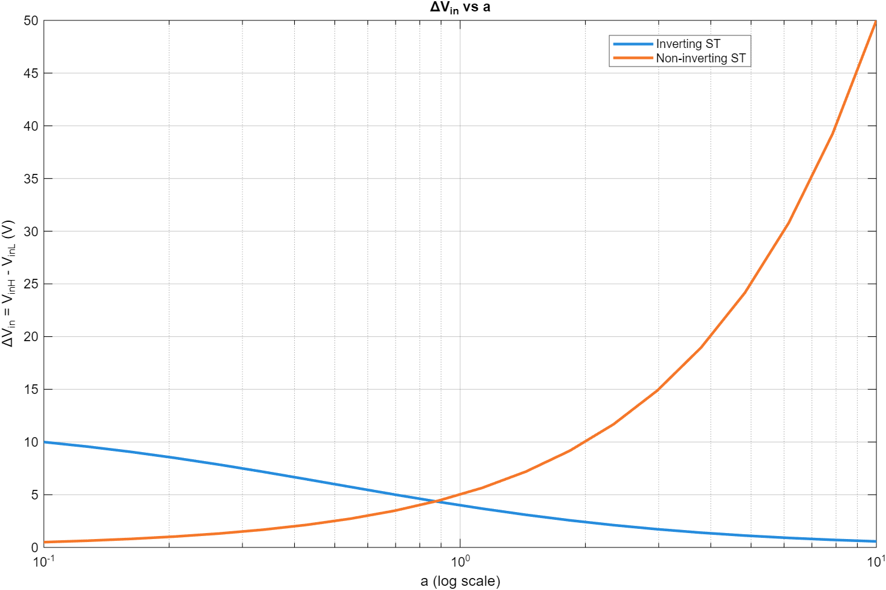

# Schmitt-trigger threshold sweeps

**EE A333L, Spring 2026.** This LM311 comparator lab compared inverting and non-inverting Schmitt triggers, using positive feedback to produce distinct rising and falling switching thresholds.

`schmitt_trigger_sweep.m` evaluates the course threshold equations across a resistor-ratio sweep from 0.1 to 10. It also varies the non-inverting reference voltage at a fixed ratio of one. The recovered script uses 20 samples across the two decades.

For the inverting model, the hysteresis width is `12/(1+2*a)` V and its midpoint is 6 V. For the non-inverting model at a 2.5 V reference and 5 V output-high level, the width is `5*a` V and its midpoint is 2.5 V. The two widths therefore change in opposite directions as the ratio increases.

The [measurement table](switching-measurements.json) comes from the February 13, 2026 team report, Table 2, with resistor ratio `a=1`. These are reported bench readings, not data regenerated by the script. The inverting low/high input thresholds were 3.90/7.85 V; the non-inverting thresholds were 0.075/4.80 V.

This is an ideal threshold model. Values outside the comparator's supply/input range are mathematical extrapolations and do not establish practical operation. Device limits, saturation, noise, and propagation delay need a circuit model or bench verification.

Course context is identified from the EE A333L Blackboard submission; the recovered report's cover retained an EE203L label. See [collaborator attribution and course context](../NOTICE.md). Original worksheets and datasheet diagrams are not redistributed.
